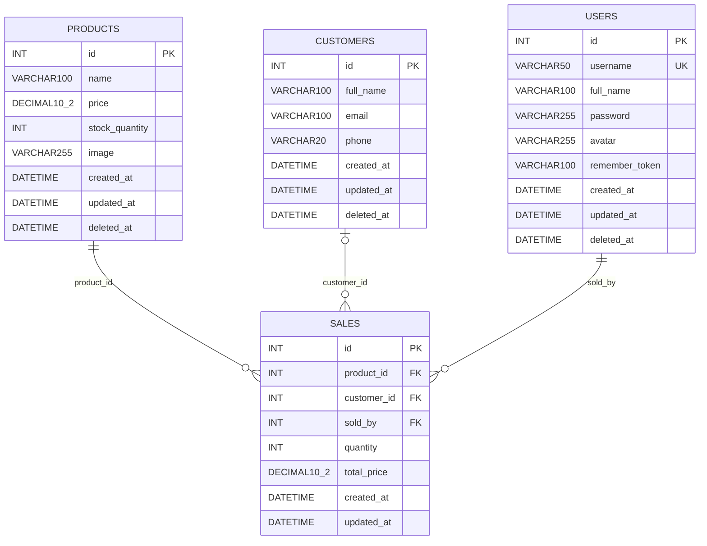

# Counter setup and deployment

Counter is the Laravel point of sale application described in `docs/implementation_plan.md`. It provides product, customer and staff CRUD, username authentication, prepared product images and avatars, a single-product sale form, stock control and sales history. The interface uses Blade, plain CSS and vanilla JavaScript; no Node.js or asset build is required.

## This Windows workspace

The recovered project database runs in normal mode on `127.0.0.1:3308`, using
MariaDB 10.4.32 from the existing XAMPP installation. Its files are private under
`storage/app/private/local-mysql`; local `.env` selects port 3308. PHP 8.3.16 is
available on PATH, and `start-local.ps1` can use that PHP executable when `.tools`
is absent. The application serves only `public/`.

From `E:\Apps\XAMPP\htdocs\Counter-POS`:

```powershell
.\scripts\start-local.ps1
```

Open <http://127.0.0.1:8000> and use the existing staff account. For a fresh
installation, choose your own `INITIAL_STAFF_PASSWORD` before seeding. Existing
account passwords are not reset by reseeding. Keep credentials and `.env` private.

Press Ctrl+C in the web-server terminal to stop the website. Use
`scripts/stop-local-database.ps1` for a graceful shutdown of this project's
database. The startup and shutdown scripts verify its data directory before
acting on port 3308. The original shared XAMPP database on port 3306 remains a
separate recovery issue; do not replace its files as part of normal POS startup.

Original database files and recovered SQL exports are kept privately under
`storage/app/private/mysql-recovery-20261115-204952`. Those files include data
from other local projects. Exclude the entire private runtime/backup contents
when preparing source for sharing. Keep only `storage/app/private/.gitignore`.

The root Apache `.htaccess` denies access to project source. Any hosted document
root must point to `public/`; image files use only the public storage disk.

## Fresh installation on another machine

Requirements:

- 64 bit PHP 8.3 or newer, Composer 2, MySQL with InnoDB and an empty development database.
- PHP extensions: ctype, curl, dom, fileinfo, filter, GD, hash, intl, mbstring, openssl, pcre, PDO, pdo_mysql, session, tokenizer, xml and zip. Enable GD with JPEG, PNG and WebP support.
- Writable `storage/` and `bootstrap/cache/`. A public storage link must be supported.
- PHP `upload_max_filesize=2M`, `post_max_size=8M` or higher, and adequate web server request limits. Accepted individual uploads remain capped at 2 MB.

The lock file resolves dependencies for PHP 8.3 and is included. Copy all application source files and `composer.lock`, excluding `.env`, `.env.testing`, `.tools`, `vendor`, all private runtime/backup data, cache files, logs and generated uploads. Keep empty storage folders and their `.gitignore` files. Then:

```bash
composer install
cp .env.example .env
php artisan key:generate
```

Create a dedicated database and set `DB_CONNECTION=mysql`, `DB_HOST`, `DB_PORT`, `DB_DATABASE`, `DB_USERNAME` and `DB_PASSWORD`. Set an initial staff username, full name and a new password in `INITIAL_STAFF_USERNAME`, `INITIAL_STAFF_NAME` and `INITIAL_STAFF_PASSWORD`. Passwords require at least eight characters and at most 72 UTF-8 bytes. Then:

```bash
php artisan migrate --seed
php artisan storage:link
# Optional fictional data, allowed only in local/testing environments:
php artisan db:seed --class=DemoDataSeeder
php artisan serve
```

On PowerShell, replace `cp` with `Copy-Item` if needed. `InitialStaffSeeder` hashes the configured secret before insertion. Running it again never resets an existing account, including a removed account. `DatabaseSeeder` provisions only the first staff member, without demo products or customers. To provision explicitly on an existing database, run `php artisan db:seed --class=InitialStaffSeeder`.

## Configuration

| Variable | Purpose |
| --- | --- |
| `APP_KEY` | Generated encryption key; keep stable across releases. |
| `APP_ENV`, `APP_DEBUG`, `APP_URL` | Environment, error display and public base URL. |
| `DB_*` | MySQL connection and credentials. |
| `SESSION_DRIVER=file`, `CACHE_STORE=file` | File sessions and login rate limiter storage. |
| `SESSION_SECURE_COOKIE` | Set `true` on the HTTPS host; `false` for local HTTP only. |
| `SESSION_HTTP_ONLY`, `SESSION_SAME_SITE` | HttpOnly cookies and `lax` same-site policy. |
| `POS_CURRENCY` | Display currency, default `PHP`; all amounts have two decimal places. |
| `POS_DISPLAY_TIMEZONE` | Display timezone, default `Asia/Manila`; database timestamps stay in UTC. |
| `INITIAL_STAFF_*` | One-time account provisioning values. |

There is one configured currency and no currency conversion. Cashiers can view products, manage customers and record sales. Admins also manage staff, products, prices and stock. New staff accounts default to cashier; the initial seeded account is an admin. Public registration, email login, password reset emails and email verification are outside scope.

## Architecture and data lifecycle

Routes call controllers; Form Requests authorize and validate; Eloquent persists; Blade renders. `RecordSale` owns sale and inventory transactions. `PrepareImage` decodes, resizes/crops and reencodes uploads. `SaveImage` coordinates file replacement with database commits. `Money` converts decimal strings to integer cents and back without floating point arithmetic.

The assignment's four core tables and relationships are retained. The following diagram shows that required core. The application also has `sale_items` for checkout lines and `stock_movements` for inventory history, plus Laravel's migration ledger:



The four supplied tables use auto-increment INT keys with matching foreign key types. The two added history/line tables use BIGINT primary keys. `customer_id` is nullable. Physical deletion of referenced parents is restricted; sales never cascade. Customer emails need not be unique. Added columns are `updated_at` on all business tables, `deleted_at` on products/customers/users and `remember_token` on users. Further additions include staff roles, sale snapshots, a unique submission reference, payment fields and a request fingerprint. Laravel's default name/email user fields, session/cache/job tables and password reset table are omitted.

Remove actions soft-delete records and preserve images. Sales relations load removed parents. A walk in sale displays **Walk in customer**. Usernames remain reserved after removal. A removed staff member cannot log in or continue an existing protected session. Staff cannot remove themselves. Password changes invalidate other sessions at their next request; the session changing its own password remains active.

Stock changes record the before/after balance, reason, timestamp and responsible staff member. Restocks and removals are available to admins on Stock history. Count corrections through Edit product require a reason, take a row lock and compare the original stock to current stock. A stale adjustment fails; an ordinary name/price/image edit preserves stock changed by a sale. Product, customer and staff removal also use transactions and row locks.

## Images

Only actual JPEG, PNG and WebP images up to 2 MB and 4096 × 4096 pixels are accepted. Corrupt files and SVG are rejected. Product images fit within 1200 × 1200 without enlargement. Avatars are center-cropped to 256 × 256. Outputs are PNG files with random UUID names on the public disk; original uploads are discarded. Database fields contain relative paths only.

New images are stored before the database update. Failed writes remove the new image. Previous images are deleted only after a successful commit; cleanup failures are logged. Soft-deleted records retain their current image.

## Sale consistency

`RecordSale` locks the active seller, selected products in ID order, and optional customer within a transaction. The database supplies price and the authenticated user supplies `sold_by`; posted totals and seller IDs are ignored. A sale and its stock decrement commit together. Insufficient stock, inactive records and totals beyond `99,999,999.99` fail without partial writes. Transactions retry deadlocks at most three times. Zero-price products are supported.

Record Sale uses one product, an optional customer and quantity. Its `sales.product_id`, `quantity` and `total_price` describe that selected product, as in the assignment. The total is calculated on the server and the stock changes in the same transaction.

Checkout is a separate optional extension at `/checkout`. For a cart, `sales` holds the checkout total and total units, while `sale_items` holds each product, its quantity, unit price and line total. The original `sales.product_id` and `unit_price` retain the first line for compatibility. Multi-product reporting must use `sale_items`; the required assignment demonstration should use Record Sale.

Saved names, prices and currency are snapshots. Earlier records are labelled where original names/currency were unavailable. A unique submission reference and request fingerprint prevent a retry from creating a second sale; changed details with the same reference are rejected. Every item has one stock movement per sale.

Checkout records cash, card or e-wallet. Card/e-wallet payments are completed externally; this application records the method and does not charge a payment provider. Cash received must cover the total and change is calculated in exact cents. Record Sale does not require payment information; history displays Not recorded for those payments. Receipts are available from Sales History and can open the browser print dialog.

## Routes

```bash
php artisan route:list --except-vendor
```

| Methods | Path | Behavior |
| --- | --- | --- |
| GET, POST | `/login` | Guest username login with normalized username/IP rate limiting. |
| POST | `/logout` | End session, invalidate session data and regenerate CSRF token. |
| GET | `/` | Protected redirect to products. |
| Resource | `/products`, `/customers`, `/staff` | Index, create, store, show, edit, PUT/PATCH update, DELETE remove. |
| GET | `/sales/create` | Required one-product Record Sale form. |
| GET | `/checkout` | Optional multi-product cart and payment form. |
| POST | `/sales` | Validate and record sale. |
| GET | `/sales` | Paginated history using saved transaction details. |
| GET | `/sales/{sale}` | Saved receipt with print control. |
| GET, POST | `/products/{product}/stock` | Admin-only stock history and adjustments. |

Staff binds `{user}` to `App\Models\User`. All management/sales routes use `auth`, active staff checking and `auth.session`. State-changing forms use CSRF tokens and method spoofing. Login failures are generic and passwords are never flashed. Templates escape supplied names.

## Tests and review

Create an empty database whose name ends in `_test`, copy `.env.testing.example` to `.env.testing`, configure its credentials and run:

```bash
php artisan key:generate --env=testing
php artisan config:clear
php artisan test
php vendor/bin/pint --format agent
composer validate --strict
```

Tests refuse to run on a database not ending in `_test`. Tests migrate/clear this dedicated database. Do not point testing at development or production data. PHPUnit's default test database is `counter_pos_test`; if selecting another `_test` name, also update `phpunit.xml` or supply its environment override.

The concurrency test spawns two PHP processes, each authenticating a separate staff member and submitting the sale route through a separate application/kernel/database connection. The parent holds the product row lock and verifies through MySQL `information_schema.PROCESSLIST` that both requests are waiting on `FOR UPDATE` before releasing it. The test requires local test-database credentials able to inspect their own connections, PHP process spawning and InnoDB. Five initial units and two requests for four units produce exactly one sale and one remaining unit. This is an overlapping test, not a sequential approximation.

The suite also covers route protection, login throttling, logout, explicit CSRF rejection, CRUD, validation, password hashing and session invalidation, image preparation and commit cleanup, stale inventory edits, exact/zero/overflow totals, forced rollback, historical relations and foreign-key restrictions. See `docs/validation.md` for the latest results and pending manual checks.

## Hosted release

No remote host has been configured. GitHub repository creation and publishing are intentionally excluded at the user's request. The application can be deployed by uploading source files directly to an authorized PHP/MySQL host.

1. Configure PHP 8.3+, MySQL InnoDB, GD, HTTPS and persistent storage. Set the web document root to **`public/`**, never the project directory. Do not serve `.tools` or environment files.
2. Upload source and `composer.lock`. Install with `composer install --no-dev --optimize-autoloader`.
3. Configure `APP_ENV=production`, `APP_DEBUG=false`, the HTTPS `APP_URL`, database credentials, `SESSION_SECURE_COOKIE=true`, file sessions/cache and currency/timezone. Generate `APP_KEY` once and preserve it. Configure trusted proxies according to the host if TLS ends at a proxy.
4. Keep database and upload backups before schema changes. Run `php artisan migrate --force`, then `php artisan storage:link`. For a first deployment only, provision staff explicitly with `php artisan db:seed --class=InitialStaffSeeder --force` and a private initial secret. Do not reseed demo data on releases.
5. Grant write access to `storage/` and `bootstrap/cache/`. Persist `storage/app/public`, logs and session/cache directories as appropriate across releases. Keep database data outside the release directory.
6. Run `php artisan config:cache`, `php artisan route:cache` and `php artisan view:cache`.
7. Complete the manual checklist in `docs/validation.md` on the actual host. Verify prepared-image URLs after redeployment, retained stock/history and logging. Retain the previous release, upload backup and database backup for recovery.

## Submission scope

The original assignment names CodeIgniter. On 16 November 2026 the user confirmed that Laravel is explicitly approved for this submission. The required Record Sale page follows the one-product workflow; Checkout remains a separate optional extension. Roles, snapshots, duplicate protection, stock history, payment recording and receipts are implemented extensions. Tax calculations and refunds are not part of the required exercise or the current implementation.

GitHub creation/publication is excluded from this task at the user's request. The original document's hosted-application requirement is not certified by local testing. No hosted URL or authorized deployment target has been supplied.

Keep screenshots of product/customer/staff CRUD, a prepared image/avatar, a successful sale, an excessive-stock rejection and history. Hosting, screenshot capture and hosted redeployment verification remain pending until a host and browser review are available. No external submission or publication has occurred.

Official framework references: [Laravel 13 runtime](https://laravel.com/framework/docs/13.x/releases), [authentication](https://laravel.com/framework/docs/13.x/authentication), [validation](https://laravel.com/framework/docs/13.x/validation), [database locks](https://laravel.com/framework/docs/13.x/queries), [storage](https://laravel.com/framework/docs/13.x/filesystem), [deployment](https://laravel.com/framework/docs/13.x/deployment).
